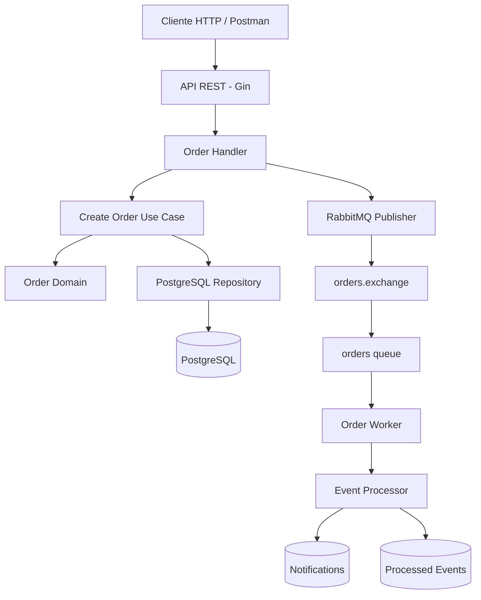

# EVENTFLOW — Sistema de Gestión de Órdenes

API REST desarrollada en Go para la gestión de órdenes, con persistencia en PostgreSQL y procesamiento asíncrono de eventos mediante RabbitMQ.

El proyecto implementa creación y consulta de órdenes, validación de datos, idempotencia, publicación de eventos, consumo mediante un worker independiente y persistencia de notificaciones y eventos procesados.

El entorno local se ejecuta mediante Docker Compose.

---

## 1. Objetivo del proyecto

Desarrollar un sistema backend que permita registrar órdenes y procesar sus eventos de forma asíncrona, aplicando separación de responsabilidades, persistencia de datos y mecanismos básicos de confiabilidad.

El flujo principal contempla:

1. Recibir una solicitud HTTP para crear una orden.
2. Validar los datos y la clave de idempotencia.
3. Persistir la orden en PostgreSQL.
4. Publicar un evento `OrderCreated` en RabbitMQ.
5. Consumir el evento mediante un worker independiente.
6. Procesar el evento y registrar la notificación correspondiente.

El proyecto prioriza una implementación reproducible y una arquitectura sencilla, evitando incorporar infraestructura innecesaria para el alcance solicitado.

## 2. Estado de implementación

| Componente | Estado |
|---|---|
| API REST con Gin | Implementado |
| Health checks v1 y v2 | Implementado |
| Métricas básicas (`/metrics`) | Implementado |
| Dominio y reglas de negocio | Implementado |
| Persistencia PostgreSQL | Implementado |
| Creación y consulta de órdenes | Implementado |
| Validación de entradas | Implementado |
| Idempotencia | Implementado |
| Publicación de eventos RabbitMQ | Implementado |
| Publisher Confirms | Implementado |
| Worker independiente | Implementado |
| Procesamiento de eventos | Implementado |
| Persistencia de notificaciones | Implementado |
| Reintentos y Dead Letter Queue | Implementado |
| Docker Compose | Implementado |
| Migraciones versionadas (golang-migrate) | Implementado |
| Timeouts HTTP y límite de body | Implementado |
| Correlación `X-Request-ID` API → worker | Implementado |
| Health/readiness con estado de dependencias | Implementado |
| Reconexión automática API/worker tras caída del broker | Implementado |
| Integración continua (GitHub Actions) | Implementado |
| Swagger | Implementado |
| Outbox Pattern | No implementado |

El proyecto cuenta con pruebas para las reglas de negocio, persistencia, idempotencia, publicación, política de reintentos/DLQ, salud y correlación. Algunos escenarios de operación pueden requerir validaciones adicionales con el broker y la base de datos reales.

## 3. Arquitectura

Se utiliza una arquitectura organizada por responsabilidades, separando el dominio, los casos de uso y los componentes de infraestructura.

### Diagrama de arquitectura



### Flujo de creación y procesamiento

1. El cliente envía una solicitud `POST /api/v1/orders`.
2. La API recibe y valida el contenido de la solicitud.
3. Se verifica la clave `Idempotency-Key`.
4. El caso de uso aplica las reglas de negocio y registra la orden.
5. El caso de uso construye el evento `OrderCreated` a partir del agregado persistido.
6. El publicador envía el evento a RabbitMQ.
7. El worker consume el mensaje.
8. El procesador registra el evento procesado y genera la notificación.
9. El consumidor confirma el mensaje cuando el procesamiento termina correctamente.

### Decisión arquitectónica

Se utiliza un monolito modular para la API y un proceso independiente para el worker.

Esta decisión permite separar la recepción de solicitudes HTTP del procesamiento asíncrono, sin introducir múltiples microservicios que aumentarían la complejidad del proyecto.

## 4. Tecnologías utilizadas

| Tecnología | Uso |
|---|---|
| Go 1.25.5 | Lenguaje de programación |
| Gin | Framework HTTP |
| PostgreSQL 15 | Persistencia relacional |
| RabbitMQ 3.13 | Mensajería asíncrona |
| Docker | Contenedores |
| Docker Compose | Orquestación local |
| pgx | Conexión con PostgreSQL |
| Zap | Logging estructurado |
| Swagger | Documentación de API |
| PowerShell | Ejecución de pruebas y comandos en Windows |

Las dependencias y sus versiones se encuentran declaradas en `go.mod` y `go.sum`.

## 5. Estructura del proyecto

```text
eventflow/
│
├── cmd/
│   ├── app/                  # Punto de entrada de la API
│   └── worker/               # Punto de entrada del worker
│
├── internal/
│   ├── order/
│   │   ├── domain/           # Entidades y reglas de negocio
│   │   ├── application/      # Casos de uso
│   │   ├── infrastructure/  # Persistencia y adaptadores
│   │   └── ...               # Componentes del módulo
│   │
│   └── ...                   # Otros módulos internos
│
├── pkg/
│   └── amqp/                 # Cliente y funcionalidades RabbitMQ
│
├── migrations/               # Migraciones versionadas (*.up.sql / *.down.sql)
│
├── docs/                     # Documentación Swagger
│
├── Dockerfile                # Imagen de la API
├── Dockerfile.worker         # Imagen del worker
├── compose.yaml              # Servicios del entorno local
├── Makefile                  # Comandos de desarrollo y pruebas
├── .env.example              # Referencia de configuración
├── .gitignore
├── go.mod
├── go.sum
├── test_e2e.ps1              # Pruebas de flujo end-to-end
├── TEST_ENDPOINTS.ps1        # Pruebas de endpoints
└── README.md
```

La estructura separa las reglas de negocio de los detalles de infraestructura. Los componentes de persistencia y mensajería se mantienen fuera del dominio.

## 6. Modelo de dominio

La entidad principal es `Order`.

Una orden contiene:

- Identificador único.
- Identificador del cliente.
- Lista de productos.
- Cantidad de cada producto.
- Precio unitario.
- Total calculado.
- Estado.
- Fecha de creación.

### Reglas de validación

Cada producto debe cumplir las siguientes condiciones:

- El identificador del producto no puede estar vacío.
- La cantidad debe ser mayor que cero.
- El precio unitario no puede ser negativo.
- El cálculo del total debe controlar posibles desbordamientos numéricos.

El total de la orden se calcula utilizando valores enteros (`int64`), evitando errores de precisión propios de los cálculos monetarios con punto flotante.

Las órdenes nuevas comienzan con estado `pending`.

## 7. Base de datos y migraciones

El proyecto utiliza PostgreSQL 15.

### Configuración local

| Parámetro | Valor |
|---|---|
| Host desde el equipo local | `localhost` |
| Host desde los contenedores | `db` |
| Puerto | `5432` |
| Base de datos | `microservice` |
| Usuario | `postgres` |
| Contraseña local de ejemplo | `postgres` |

### Tablas principales

La base de datos contempla las siguientes tablas:

- `orders`: información principal de las órdenes.
- `order_items`: productos asociados a cada orden.
- `health_checks`: registros relacionados con verificaciones de salud.
- `notifications`: notificaciones generadas durante el procesamiento.
- `processed_events`: eventos procesados por el worker.

### Migraciones versionadas

Las migraciones se gestionan con **golang-migrate**. Cada versión tiene su archivo `*.up.sql` y `*.down.sql` en `migrations/`, y el estado se registra en la tabla `schema_migrations` (`version` + `dirty`).

Docker Compose incluye un servicio `migrate` que aplica automáticamente las migraciones pendientes antes de arrancar la API y el worker:

```text
db (healthy) → migrate (up) → app + worker
```

Las migraciones están escritas de forma **idempotente** (`IF NOT EXISTS` y comprobación de constraints) para poder baselinar bases de datos creadas antes de adoptar el gestor: en ese caso, la primera ejecución registra la versión sin volver a crear objetos.

Comandos útiles:

```powershell
# Aplicar migraciones pendientes manualmente
docker compose run --rm migrate

# Ver la versión aplicada
docker compose run --rm migrate -path=/migrations `
  -database "postgres://postgres:postgres@db:5432/microservice?sslmode=disable" version

# Revertir la última migración
docker compose run --rm migrate -path=/migrations `
  -database "postgres://postgres:postgres@db:5432/microservice?sslmode=disable" down 1

# Reaplicar todas
docker compose run --rm migrate -path=/migrations `
  -database "postgres://postgres:postgres@db:5432/microservice?sslmode=disable" up
```

Si una migración falla, `schema_migrations.dirty` queda en `true` y el servicio `migrate` termina con error, bloqueando el arranque de la API y el worker hasta corregirlo.

### Migraciones disponibles

| Versión | Contenido |
|---|---|
| `001` | Tabla `health_checks` |
| `002` | Tablas `orders` y `order_items` + índices |
| `003` | Idempotencia: `idempotency_key`, `request_hash` y constraints |
| `004` | `processed_events` (deduplicación) y `notifications` |

## 8. Instalación y ejecución

### Requisitos

- Docker Desktop.
- Docker Compose.
- Git para clonar el repositorio.
- PowerShell para ejecutar los ejemplos de prueba.

No es necesario instalar PostgreSQL ni RabbitMQ directamente en el equipo cuando se utiliza Docker Compose.

### Clonar el repositorio

```powershell
git clone <URL_DEL_REPOSITORIO>
cd eventflow
```

### Levantar el proyecto

Ejecutar:

```powershell
docker compose up --build -d
```

Este comando construye las imágenes y levanta los servicios:

| Servicio | Función | Puerto |
|---|---|---|
| `db` | PostgreSQL | 5432 |
| `rabbitmq` | RabbitMQ | 5672 |
| `rabbitmq` | Panel de administración | 15672 |
| `migrate` | Aplica migraciones y termina | — |
| `app` | API REST | 3200 |
| `worker` | Consumidor de eventos y métricas | 9090 |

El arranque respeta las dependencias: PostgreSQL y RabbitMQ deben superar sus healthchecks, el servicio `migrate` debe terminar correctamente y solo entonces arrancan la API y el worker. Ambos tienen `restart: unless-stopped` y healthchecks propios (la API mediante `microservice healthcheck` contra `/api/v1/health` y el worker contra `/healthz`).

### Revisar los servicios

```powershell
docker compose ps
```

### Consultar logs

```powershell
docker compose logs -f app
docker compose logs -f db
docker compose logs -f rabbitmq
docker compose logs -f worker
```

### Detener el proyecto

```powershell
docker compose down
```

Este comando detiene y elimina los contenedores, pero conserva los volúmenes persistentes.

**Importante:** no utilizar `docker compose down -v` como procedimiento habitual. La opción `-v` elimina los volúmenes y, por tanto, los datos persistidos de PostgreSQL y RabbitMQ.

### Configuración de entorno

El archivo `.env.example` contiene una referencia de las variables de configuración del proyecto.

El `compose.yaml` actual define directamente buena parte de la configuración de la API, el worker y PostgreSQL. Para RabbitMQ permite sobrescribir el usuario y la contraseña mediante `RABBITMQ_USER` y `RABBITMQ_PASSWORD`, utilizando `guest` como valor predeterminado.

Además, la API aplica límites de entrada configurables por entorno:

| Variable | Valor por defecto | Uso |
|---|---|---|
| `REQUEST_TIMEOUT_SECONDS` | `10` | Deadline máximo por petición HTTP (incluye queries y publicación de eventos) |
| `MAX_BODY_BYTES` | `1048576` | Tamaño máximo del cuerpo de la petición |
| `WORKER_PROCESSING_TIMEOUT_SECONDS` | `30` | Deadline máximo para procesar un mensaje en el worker |
| `RABBITMQ_RETRY_DELAY_MS` | `5000` | Espera base del primer reintento |
| `RABBITMQ_MAX_RETRY_DELAY_MS` | `60000` | Tope de la espera con backoff exponencial |

Los archivos de entorno locales, como `.env.dev` y `.env.qa`, no deben publicarse en el repositorio.

## 9. API REST

La API queda disponible en:

```text
http://localhost:3200
```

### Health check v1

```http
GET /api/v1/health
```

Permite verificar el estado de la API, su conexión con PostgreSQL y el estado opcional de RabbitMQ.

```json
{
  "timestamp": "2026-11-21T10:30:00Z",
  "service": "microservice",
  "status": "ok",
  "database": "connected",
  "rabbitmq": "connected"
}
```

Estados:

| `status` | HTTP | Significado |
|---|---|---|
| `ok` | 200 | Base de datos y broker disponibles |
| `degraded` | 200 | Base de datos disponible, broker caído: la API sigue aceptando pedidos y omite la publicación |
| `unhealthy` | 503 | Base de datos no disponible: la API no puede persistir pedidos |

### Health check v2

```http
GET /api/v2/health
```

Segunda versión del endpoint de salud.

Los healthchecks permiten verificar la disponibilidad de la aplicación y el estado de sus dependencias. La caída de RabbitMQ no marca la API como no lista porque el servicio opera en modo degradado; la caída de PostgreSQL sí devuelve `503`.

### Crear una orden

```http
POST /api/v1/orders
```

Headers:

```http
Content-Type: application/json
Idempotency-Key: order-example-001
X-Request-ID: order-example-001
```

`X-Request-ID` es opcional: si no se envía, la API genera uno y lo devuelve en la respuesta. Se propaga al evento y al worker para correlacionar los logs.

Body:

```json
{
  "customer_id": "customer-001",
  "items": [
    {
      "product_id": "product-001",
      "quantity": 2,
      "unit_price": 2500
    },
    {
      "product_id": "product-002",
      "quantity": 1,
      "unit_price": 5000
    }
  ]
}
```

El total esperado es:

```text
10000
```

La respuesta exitosa utiliza el código HTTP `201 Created` y entrega los datos de la orden creada: `id`, `status` (`pending`) y `created_at`.

### Consultar una orden

```http
GET /api/v1/orders/{id}
```

Ejemplo:

```http
GET /api/v1/orders/799207fe-4e4e-4ced-b0ca-454fe7391efd
```

La API devuelve la información de la orden si existe. En caso contrario, responde con `404 Not Found`.

### Códigos de respuesta relevantes

| Código | Significado |
|---|---|
| 201 | Orden creada |
| 200 | Consulta exitosa |
| 400 | Solicitud inválida |
| 404 | Orden no encontrada |
| 409 | Conflicto de idempotencia |
| 413 | Cuerpo de la petición demasiado grande |
| 500 | Error interno |

### Formato de errores

Los errores de los endpoints de órdenes usan una estructura única:

```json
{
  "error": {
    "type": "VALIDATION_ERROR",
    "code": "ORDER_INVALID",
    "message": "items[0].quantity must be greater than 0"
  },
  "timestamp": "2026-11-18T12:00:00Z"
}
```

Los errores `500` solo exponen `INTERNAL_ERROR` con el mensaje `internal server error`; el detalle técnico (SQL, driver, stack) queda únicamente en los logs del servidor.

### Swagger

La documentación interactiva se encuentra disponible en:

```text
http://localhost:3200/docs/index.html
```

### Métricas operativas

```http
GET /metrics
```

Expone métricas en formato texto de Prometheus. El endpoint se registra fuera de `/api` y antes de los middlewares de negocio, de modo que el scraping no altere las métricas de tráfico ni los logs de acceso.

| Métrica | Tipo | Etiquetas | Significado |
|---|---|---|---|
| `http_requests_total` | counter | `method`, `route`, `status` | Peticiones HTTP atendidas |
| `http_request_duration_seconds` | summary | `method`, `route` | Latencia acumulada (suma y cantidad) |
| `orders_created_total` | counter | — | Órdenes nuevas persistidas |
| `orders_idempotent_replays_total` | counter | — | Reintentos con la misma clave que devolvieron la orden existente |
| `order_events_published_total` | counter | — | Eventos publicados con confirmación |
| `order_event_publish_failures_total` | counter | — | Fallos de publicación |
| `order_event_publish_skipped_total` | counter | — | Eventos omitidos por broker no disponible |
| `worker_messages_processed_total` | counter | — | Mensajes procesados correctamente |
| `worker_messages_failed_total` | counter | — | Procesamientos fallidos |
| `worker_messages_invalid_total` | counter | — | Mensajes que no se pudieron deserializar |
| `worker_messages_retried_total` | counter | `retry` | Mensajes enviados a la cola de reintento |
| `worker_messages_dead_lettered_total` | counter | `reason` | Mensajes enviados a la DLQ |
| `worker_publish_failures_total` | counter | `target` | Fallos al publicar un reintento o la DLQ |
| `worker_processing_duration_seconds` | summary | `consumer` | Tiempo de procesamiento de eventos |

Ejemplo:

```powershell
curl.exe -s http://localhost:3200/metrics
```

```text
# TYPE http_requests_total counter
http_requests_total{method="POST",route="/api/v1/orders",status="201"} 3
# TYPE orders_created_total counter
orders_created_total 3
# TYPE worker_messages_retried_total counter
worker_messages_retried_total{retry="1"} 1
```

Las métricas se mantienen en memoria del proceso y se reinician con él. Para producción se recomienda exportarlas a Prometheus u OpenTelemetry y proteger el endpoint en una red interna. La etiqueta `route` usa el patrón registrado, no la URL concreta, para evitar una cardinalidad ilimitada.

## 10. Idempotencia

La creación de órdenes utiliza el header `Idempotency-Key`.

Su objetivo es evitar que una misma solicitud genere múltiples órdenes cuando el cliente reintenta una operación.

Se contemplan dos situaciones principales:

**Misma clave y mismo contenido**

La solicitud repetida no debe generar una nueva orden y devuelve la orden previamente registrada.

**Misma clave y contenido diferente**

La API responde con `409 Conflict`, evitando reutilizar una clave para operaciones distintas.

Se contemplan pruebas de repetición, conflicto de contenido y comportamiento concurrente de la idempotencia.

La idempotencia se aplica a la creación de órdenes; no reemplaza un mecanismo de transacciones distribuidas entre PostgreSQL y RabbitMQ.

## 11. Mensajería asíncrona con RabbitMQ

RabbitMQ permite desacoplar la creación de órdenes del procesamiento posterior de sus eventos.

### Configuración

| Elemento | Nombre |
|---|---|
| Exchange | `orders.exchange` |
| Tipo | `topic` |
| Cola principal | `orders` |
| Cola de reintentos | `orders.retry.1`, `orders.retry.2`, `orders.retry.3` |
| Dead Letter Queue | `orders.dlq` |
| Routing key | `order.created` |

Las colas se configuran como durables.

Cada intento usa una cola de reintentos distinta (`RABBITMQ_QUEUE_ORDERS_RETRY` + número de intento) con su propio TTL, de modo que la espera crece de forma exponencial: 5000 ms, 10000 ms y 20000 ms con los valores por defecto. `RABBITMQ_RETRY_DELAY_MS` define la espera base y `RABBITMQ_MAX_RETRY_DELAY_MS` el máximo. Tras el TTL, el Dead Letter Exchange devuelve el mensaje a la cola principal.

### Evento OrderCreated

Al crear una orden se construye un evento de dominio a partir del agregado persistido (no del DTO HTTP), con importes enteros. Ejemplo:

```json
{
  "event_id": "order.created.799207fe-4e4e-4ced-b0ca-454fe7391efd",
  "event_type": "order.created",
  "timestamp": "2026-11-19T10:30:00Z",
  "order_id": "799207fe-4e4e-4ced-b0ca-454fe7391efd",
  "customer_id": "customer-001",
  "total_amount": 10000,
  "request_id": "order-example-001"
}
```

El `request_id` viaja también en la cabecera AMQP `x-request-id`; el worker lo usa en sus logs.

El evento se publica desde el caso de uso. Si la publicación falla después de persistir el pedido, la API responde `201` igualmente y registra el error; un reintento del cliente con la misma `Idempotency-Key` vuelve a publicar el evento (el `event_id` es estable y el consumidor es idempotente).

### Worker

El worker se ejecuta como un proceso independiente de la API.

Sus responsabilidades son:

1. Conectarse a RabbitMQ.
2. Consumir mensajes de la cola principal.
3. Procesar los eventos recibidos.
4. Registrar los eventos procesados.
5. Generar las notificaciones correspondientes.
6. Confirmar los mensajes procesados correctamente.

El consumidor utiliza ACK manual y QoS para limitar la cantidad de mensajes entregados simultáneamente. Cada mensaje se procesa con un deadline propio (`WORKER_PROCESSING_TIMEOUT_SECONDS`, 30 s por defecto): si se agota, el procesamiento se considera fallido y el mensaje entra en el flujo de reintentos. La publicación en las colas de reintento o en la DLQ usa un contexto independiente del deadline de procesamiento.

Política de confirmación:

- `ACK` solo cuando el procesamiento terminó correctamente o el mensaje quedó registrado en la DLQ.
- `NACK` con `requeue` si no se pudo publicar el reintento, para no perder el mensaje.
- `NACK` sin `requeue` para mensajes malformados que tampoco pudieron enviarse a la DLQ.
- Los duplicados se detectan por `event_id` + `consumer_name` en `processed_events`.

### Publisher Confirms

El publicador utiliza Publisher Confirms para recibir confirmaciones del broker sobre las publicaciones.

La correlación de confirmaciones usa la API de confirmaciones diferidas del cliente AMQP, que asigna el *delivery tag* bajo lock y es segura cuando varios requests publican concurrentemente sobre el mismo canal. Un mensaje declarado `mandatory` que no puede enrutarse produce un `basic.return`, que el publicador detecta y reporta como error (RabbitMQ confirma el mensaje igualmente, por lo que el ACK por sí solo no basta).

Esto permite mejorar la confiabilidad de la publicación, aunque no garantiza por sí solo la entrega de eventos de extremo a extremo ni reemplaza el patrón Outbox.

### Reintentos y Dead Letter Queue

Cuando ocurre un error durante el procesamiento, el sistema contempla mecanismos de reintento y una cola de mensajes fallidos.

El objetivo es evitar perder inmediatamente un mensaje que no pudo procesarse y permitir aislar los mensajes que agotan los intentos configurados.

La configuración contempla hasta tres reintentos. Cada reintento se publica en una cola con TTL creciente (`orders.retry.1`, `orders.retry.2`, `orders.retry.3`), por lo que la espera no es fija. La cabecera `x-retry-count` registra el intento y, al superar `RABBITMQ_MAX_RETRIES`, el mensaje se publica en `orders.dlq` con la cabecera `x-dead-letter-reason`.

La estrategia de reintentos y DLQ debe considerarse junto con la idempotencia del procesamiento para evitar efectos duplicados.

## 12. Confiabilidad y limitaciones conocidas

El proyecto implementa distintos mecanismos para mejorar la confiabilidad:

- Validación de entradas.
- Idempotencia en la creación de órdenes.
- Persistencia en PostgreSQL.
- Publisher Confirms.
- Manejo de NACK y timeout.
- ACK manual del consumidor.
- Reintentos y Dead Letter Queue.
- Persistencia de eventos procesados.
- Cierre controlado de procesos.
- Arranque de la API en modo degradado si RabbitMQ no está disponible.
- Reconexión automática de API y worker tras una caída o reinicio del broker.

### API con el broker no disponible

La API no depende de RabbitMQ para arrancar. Si la conexión o la declaración de colas falla, el servicio registra el error y arranca en modo degradado: `POST /orders` sigue persistiendo pedidos, `GET /orders/{id}` y los healthchecks funcionan, y la publicación de eventos se registra como fallo (contador `order_event_publish_failures_total`). La conexión es perezosa y se recupera sola: al volver el broker, el siguiente `POST`, un nuevo consumo del worker o un healthcheck restablecen la conexión, reaplican publisher confirms, QoS y la topología (exchanges, colas, reintentos y DLQ). El worker reintenta el consumo cada pocos segundos si el canal de deliveries se cierra.

### Correlación de solicitudes y eventos

Cada petición HTTP recibe un `X-Request-ID`: se respeta el enviado por el cliente si es válido o se genera uno nuevo. El identificador:

- Se devuelve en la respuesta HTTP.
- Se incluye en los logs estructurados de acceso y de error.
- Se guarda en el contexto de la petición y lo usa el caso de uso.
- Viaja en el evento (`request_id`) y en la cabecera AMQP `x-request-id`.
- El worker lo recupera y lo añade a sus logs, incluyendo reintentos y DLQ.

Esto permite seguir un pedido desde el `POST` hasta su notificación sin registrar datos sensibles.

### Limitación: publicación después de persistir

Actualmente, la orden se persiste en PostgreSQL antes de publicar el evento en RabbitMQ.

Si la publicación falla después de que la orden fue guardada, la API conserva la orden y registra el error de publicación, pero no revierte automáticamente la operación ya persistida.

Esto significa que puede existir una orden registrada cuyo evento no haya llegado al broker.

### Outbox Pattern

Una mejora futura sería implementar el patrón Transactional Outbox.

Este patrón permitiría registrar la orden y el evento pendiente de publicación dentro de una misma transacción de PostgreSQL. Un proceso independiente podría publicar posteriormente los eventos pendientes.

No se implementó en esta versión porque se priorizó mantener el alcance y la complejidad de la solución acotados.

### Otras limitaciones y mejoras futuras

- Incorporar un gestor de migraciones versionadas.
- Profundizar las pruebas de fallos y recuperación de RabbitMQ con un broker real.
- Exportar las métricas a Prometheus u OpenTelemetry y añadir trazas distribuidas.
- Incorporar Outbox para resolver la brecha entre persistencia y publicación.

### Preguntas de diseño y respuestas

**¿Qué ocurre si el cliente repite el `POST` porque no recibió respuesta?**

La cabecera `Idempotency-Key` es obligatoria. La orden guarda la clave y un hash SHA-256 del contenido:

- Misma clave y mismo contenido: no se crea otra orden; se devuelve la existente (`201` con el mismo ID).
- Misma clave y contenido distinto: `409 ORDER_IDEMPOTENCY_CONFLICT`.
- Sin clave: `400 ORDER_IDEMPOTENCY_KEY_INVALID`.

La comprobación e inserción ocurren en la misma transacción, y hay pruebas secuenciales y concurrentes.

**¿Qué ocurre si el worker procesa el evento y falla antes de confirmar el mensaje?**

El consumo es *at-least-once*. Si el proceso muere antes del ACK, RabbitMQ reentrega el mensaje. Para evitar efectos duplicados, el worker registra `event_id + consumer_name` en `processed_events` y crea la notificación en la **misma transacción**; si ya existe, hace ACK sin repetir el trabajo. Los duplicados quedan documentados como comportamiento esperado.

**¿Cómo se evita perder el evento si la base de datos confirma el pedido pero el broker no está disponible?**

Actualmente no se garantiza entrega exacta: la orden se confirma en PostgreSQL y después se publica. Si la publicación falla, el pedido queda persistido, se registra el fallo (`order_event_publish_failures_total` y log con `request_id`) y el cliente puede reintentar con la misma `Idempotency-Key`, lo que vuelve a disparar la publicación sin duplicar la orden. La solución completa es **Transactional Outbox** (registrar el evento pendiente en la misma transacción y publicarlo desde un relay), documentada como siguiente paso y no exigida en el alcance inicial.

**¿Qué debe ocurrir durante un apagado mientras se procesa un mensaje?**

- API: al recibir `SIGINT`/`SIGTERM` deja de aceptar conexiones (`http.Server.Shutdown`) y espera hasta `SHUTDOWN_TIMEOUT` a las peticiones en curso; después cierra AMQP y PostgreSQL.
- Worker: cancela el consumidor, deja de tomar mensajes nuevos y espera a que `processingCount` llegue a cero dentro del mismo límite. Si el mensaje no termina, no se hace ACK y RabbitMQ lo reentrega.

**¿Qué componentes pueden seguir siendo módulos del mismo servicio y por qué?**

La API y el worker son procesos separados porque tienen ciclos de vida y escalado distintos (la API escala por tráfico HTTP; el worker por backlog de la cola). El resto —salud, métricas, cliente AMQP, configuración— son módulos internos reutilizados por ambos. No se separaron en microservicios porque no aporta valor: comparten dominio y contratos y un despliegue conjunto simplifica la operación.

## 13. Pruebas

El proyecto incluye pruebas automatizadas y scripts para verificar los endpoints y el flujo completo.

### Pruebas automatizadas Go

Para ejecutar todas las pruebas:

```powershell
go test -count=1 ./...
```

Para ejecutar con mayor detalle:

```powershell
go test -v -count=1 ./...
```

Si se desea utilizar un entorno Go en Docker:

```powershell
docker run --rm `
  --mount "type=bind,source=$($PWD.Path),target=/app,readonly" `
  --workdir /app `
  golang:1.25.5-alpine `
  go test -count=1 ./...
```

Las pruebas que requieren servicios externos se omiten automáticamente si PostgreSQL o RabbitMQ no están disponibles, de modo que `go test ./...` funciona sin Docker. Para ejecutar las integraciones, levanta las dependencias y vuelve a lanzar las pruebas.

Cobertura destacada de pruebas unitarias:

- Casos de uso de órdenes: validación, idempotencia, publicación y replay.
- Consumidor: ACK/NACK, reintentos por intento, DLQ, mensajes malformados y timeout de procesamiento.
- Health: `ok`, `degraded` y `unhealthy` (503).
- Middleware y `reqid`: generación, validación y propagación de `X-Request-ID`.
- Backoff exponencial y lectura de cabeceras AMQP.
- Cliente AMQP: reconexión tras pérdida de conexión, ejecución de hooks de topología, cliente perezoso, recuperación de readiness y bloqueo tras `Close`.

### Scripts de prueba

**Pruebas end-to-end**

```powershell
.\test_e2e.ps1
```

Este script permite verificar el flujo principal de la aplicación, incluyendo disponibilidad, creación de órdenes, persistencia, procesamiento asíncrono e idempotencia.

**Pruebas de endpoints**

```powershell
.\TEST_ENDPOINTS.ps1
```

Permite verificar los endpoints disponibles y sus respuestas.

### Integración continua

El workflow `.github/workflows/ci.yml` se ejecuta en cada `push` a `main`/`master`, en pull requests y manualmente. Levanta PostgreSQL 15 y RabbitMQ 3.13 como `services`, aplica las migraciones y ejecuta:

- Comprobación de formato con `gofmt`.
- `go mod tidy -diff` para detectar dependencias desactualizadas.
- `go vet ./...` y `go build ./...`.
- Escaneo de secretos con `gitleaks` y de vulnerabilidades con `govulncheck`.
- `go test -count=1 ./...` (incluye integraciones contra los servicios).
- `go test -race -count=1 ./...`.

Si algo falla, publica los logs de los contenedores de PostgreSQL y RabbitMQ para facilitar el diagnóstico.

### Makefile

El proyecto incluye comandos para facilitar la ejecución de tareas habituales:

```powershell
make help
make test
make test-coverage
make test-unit
make test-integration
make test-business
```

La disponibilidad de estos comandos depende de los targets definidos en el `Makefile`. En Windows se puede utilizar un entorno compatible con Make o ejecutar directamente los comandos Go.

### Escenarios de prueba contemplados

| Escenario | Comportamiento esperado |
|---|---|
| Crear una orden válida | La orden se registra |
| Consultar una orden existente | Se devuelve la orden |
| Consultar una orden inexistente | Respuesta 404 |
| Cantidad negativa o cero | Validación rechaza la entrada |
| Precio negativo | Validación rechaza la entrada |
| Cliente o productos faltantes | Solicitud inválida |
| Misma clave y mismo contenido | No crea una segunda orden |
| Misma clave y contenido diferente | Conflicto 409 |
| Evento nulo | El publicador rechaza la operación |
| Timeout de publicación | Se informa el fallo |
| NACK del broker | Se maneja la confirmación negativa |
| Mensaje obligatorio no enrutado | Se contempla el caso de publicación sin ruta |
| Desbordamiento del total | Se rechaza el cálculo inválido |
| Error de procesamiento | Reintento en la cola del intento correspondiente |
| Reintentos agotados | Mensaje publicado en `orders.dlq` con motivo |
| Fallo al publicar reintento/DLQ | NACK con requeue para no perder el mensaje |
| Mensaje malformado | Se envía directamente a la DLQ |
| Timeout de procesamiento | Se trata como fallo transitorio y se reintenta |
| Broker caído al arrancar | La API inicia en modo degradado y el health responde `degraded` |
| Broker reiniciado en caliente | La API y el worker reconectan, restauran topología y vuelven a publicar/consumir sin reiniciar contenedores |
| Base de datos caída | Health responde `503` con `status: unhealthy` |
| Consulta de métricas | `/metrics` expone contadores de peticiones, órdenes, eventos y worker |
| Reintento idempotente | Incrementa `orders_idempotent_replays_total` sin sumar `orders_created_total` |

Los escenarios anteriores corresponden a los casos contemplados en las pruebas y en la implementación.

### Demostración de escenarios de fallo

**1. RabbitMQ no disponible**

```powershell
docker compose stop rabbitmq
curl.exe -i -X POST http://localhost:3200/api/v1/orders `
  -H "Content-Type: application/json" `
  -H "Idempotency-Key: fallo-broker-001" `
  -H "X-Request-ID: demo-broker-down" `
  -d '{"customer_id":"cust-1","items":[{"product_id":"p1","quantity":1,"unit_price":1000}]}'
curl.exe -s http://localhost:3200/api/v1/health
```

Resultado esperado: `POST` devuelve `201`, el pedido queda persistido y el log registra `event publication skipped` / `event publication failed` con `request_id=demo-broker-down`. El health responde `200` con `status: degraded` y `rabbitmq: disconnected`. Al reiniciar RabbitMQ, un nuevo pedido vuelve a publicar eventos.

**2. Fallo transitorio del worker y agotamiento de reintentos**

Se detiene PostgreSQL y se publica un evento válido directamente en el exchange; el worker no podrá procesarlo y entrará en el flujo de reintentos:

```powershell
docker compose stop db
docker compose exec rabbitmq rabbitmqadmin publish exchange=orders.exchange routing_key=order.created payload='{"event_id":"order.created.demo-retry","event_type":"order.created","timestamp":"2026-11-21T10:30:00Z","order_id":"demo-retry","customer_id":"cust-1","total_amount":1000,"request_id":"demo-retry"}'
docker compose logs -f worker
```

Resultado esperado: el worker registra el fallo, publica en `orders.retry.1`, luego `.2` y `.3`, y finalmente en `orders.dlq` con `x-dead-letter-reason=max_retries_exceeded`. El mensaje original solo se confirma cuando el reintento o la DLQ quedaron publicados.

Inspección de colas:

```powershell
docker compose exec rabbitmq rabbitmqctl list_queues name messages
```

**3. Mensaje malformado**

```powershell
docker compose exec rabbitmq rabbitmqadmin publish exchange=orders.exchange routing_key=order.created payload="{"
```

Resultado esperado: el worker lo envía a `orders.dlq` con `x-dead-letter-reason=invalid_message` y no entra en el ciclo de reintentos.

## 14. Evidencia de ejecución

Salidas reales obtenidas el **2026-11-22** sobre Windows 11 con `docker compose up -d --build` (PostgreSQL 15, RabbitMQ 3.13, API y worker). Los identificadores y fechas se conservan; no se registran datos sensibles.

### 14.1. Migraciones y flujo base

Al levantar el entorno, el servicio `migrate` aplica las versiones pendientes y termina:

```text
1/u create_health_check
2/u create_orders_tables
3/u order_idempotency
4/u event_processing
```

```text
$ docker compose exec -T db psql -U postgres -d microservice -c "select version, dirty from schema_migrations;"
 version | dirty
---------+-------
       4 | f
$ docker compose run --rm migrate
no change
```

```powershell
curl.exe -s -X POST http://localhost:3200/api/v1/orders `
  -H "Content-Type: application/json" `
  -H "Idempotency-Key: demo-ok-001-run2" `
  -H "X-Request-ID: demo-ok-001" `
  -d '{"customer_id":"customer-demo-ok","items":[{"product_id":"prod-1","quantity":2,"unit_price":1500}]}'
```

Respuesta `201`:

```json
{"id":"312f9c0f-c791-4f92-9cb6-34749143d7d8","status":"pending","created_at":"2026-11-22T21:25:21.812846Z"}
```

`GET /api/v1/orders/{id}` devuelve `200` con `total_amount: 3000` y `status: "pending"`. El worker registra la notificación con la misma correlación:

```text
[INFO] Event processed successfully
{"event_id":"order.created.312f9c0f-...","order_id":"312f9c0f-...","consumer":"order-worker","request_id":"demo-ok-001"}
[INFO] message processed successfully
{"message_id":"order.created.312f9c0f-...","request_id":"demo-ok-001"}
```

### 14.2. Broker caído y recuperación

```powershell
docker compose stop rabbitmq
# POST con Idempotency-Key demo-broker-down-002 y X-Request-ID demo-broker-down-002
```

- `POST /api/v1/orders` responde `201` y la orden queda persistida.
- Log de la API:

```text
[ERROR] order persisted but event publication failed
{"order_id":"934d718f-...","event_id":"order.created.934d718f-...","request_id":"demo-broker-down-002",
 "error":"failed to publish order created event: failed to connect to RabbitMQ: ..."}
```

- `GET /api/v1/health` responde `200`:

```json
{"status":"degraded","database":"connected","rabbitmq":"disconnected"}
```

- `/metrics` incrementa `order_event_publish_failures_total 1`.
- Al ejecutar `docker compose start rabbitmq`, el health vuelve a `ok` y un pedido nuevo se publica y consume:

```text
[INFO] Connected to RabbitMQ            // API: reconexión + topología restaurada
[INFO] Order created event published    {"request_id":"demo-broker-back-002"}
[WARN] RabbitMQ deliveries channel closed; reconnecting   // worker
[INFO] Worker started, listening for messages
[INFO] Event processed successfully     {"request_id":"demo-broker-back-002"}
```

> Durante la primera pasada la API **no** reconectaba: mantenía `channel/connection is not open` y el health quedaba en `degraded` hasta reiniciar el contenedor. El fallo se corrigió en el commit `531c370` (reconexión perezosa, restauración de confirms/topología/QoS y reintento de consumo en el worker). La evidencia anterior corresponde a la versión corregida.

### 14.3. Reintentos y DLQ con PostgreSQL caído

```powershell
docker compose stop db
# evento válido publicado directamente en orders.exchange con routing key order.created
# X-Request-ID: demo-db-down-001
```

Logs del worker:

```text
[ERROR] failed to process event   {"retry_count":0,"error":"failed to begin transaction: ..."}
[INFO]  message sent to retry queue {"retry_count":1,"queue":"orders.retry.1","delay_ms":5000}
[ERROR] failed to process event   {"retry_count":1}
[INFO]  message sent to retry queue {"retry_count":2,"queue":"orders.retry.2","delay_ms":10000}
[ERROR] failed to process event   {"retry_count":2}
[INFO]  message sent to retry queue {"retry_count":3,"queue":"orders.retry.3","delay_ms":20000}
[ERROR] failed to process event   {"retry_count":3}
[ERROR] max retries exceeded, sending to DLQ
[INFO]  message sent to DLQ       {"retry_count":3,"reason":"max_retries_exceeded","routing_key":"dead-letter.retry"}
```

```text
$ docker compose exec -T rabbitmq rabbitmqctl list_queues name messages
name             messages
orders           0
orders.retry.1   0
orders.retry.2   0
orders.retry.3   0
orders.dlq       1
```

Cabeceras del mensaje en la DLQ (Management API):

```json
{
  "x-dead-letter-reason": "max_retries_exceeded",
  "x-retry-count": 3,
  "x-request-id": "demo-db-down-001",
  "x-death": [
    {"queue": "orders.retry.1", "reason": "expired"},
    {"queue": "orders.retry.2", "reason": "expired"},
    {"queue": "orders.retry.3", "reason": "expired"}
  ]
}
```

Tras `docker compose start db`, el health vuelve a `ok` y la API sigue operando.

### 14.4. Mensaje malformado

Se publica `payload="{"` en `orders.exchange` con `order.created`:

```text
[ERROR] failed to parse message, sending to DLQ {"message_id":"malformed-demo-001","error":"failed to unmarshal event: unexpected end of JSON input"}
[INFO]  message sent to DLQ {"reason":"invalid_message","retry_count":0}
```

La cola `orders.dlq` pasa a 2 mensajes; no hay reintentos.

### 14.5. Pruebas automatizadas

```text
$ go test -count=1 ./...
ok   microservice/internal/health/application/usecase
ok   microservice/internal/health/presentation/handler
ok   microservice/internal/order/application/usecase
ok   microservice/internal/order/domain/entity
ok   microservice/internal/order/infrastructure
ok   microservice/internal/order/infrastructure/eventpublisher
ok   microservice/internal/order/infrastructure/processor
ok   microservice/internal/order/infrastructure/queue
ok   microservice/internal/order/presentation/handler
ok   microservice/internal/order/presentation/router
ok   microservice/pkg/amqp
ok   microservice/pkg/httputil
ok   microservice/pkg/middleware
ok   microservice/pkg/reqid
```

Notas de entorno:

- En esta máquina Windows una política de Application Control bloquea la ejecución de algunos binarios de test desde `%TEMP%` (`consumer.test.exe`, `metrics.test.exe`). Compilados con `go test -c` y ejecutados desde el repositorio, ambos terminan en `PASS`.
- `go test -race` no pudo ejecutarse porque no hay compilador C (`gcc`) disponible para `CGO_ENABLED=1`; queda pendiente validarlo en CI o en Linux.
- Las pruebas de integración de `pkg/amqp` e `internal/order/infrastructure` se ejecutaron contra el RabbitMQ y PostgreSQL de Docker Compose.

## 15. Decisiones técnicas y trade-offs

| Decisión | Motivo | Trade-off |
|---|---|---|
| Go | Lenguaje eficiente y adecuado para servicios backend | Requiere definir explícitamente estructuras y manejo de errores |
| Gin | Framework HTTP liviano | Incorpora una dependencia adicional |
| PostgreSQL | Persistencia relacional y transacciones | Requiere administrar esquema y migraciones |
| RabbitMQ | Procesamiento asíncrono y desacoplamiento | Introduce complejidad operacional |
| Worker independiente | Separa procesamiento de solicitudes HTTP | Requiere administrar otro proceso |
| Docker Compose | Entorno local reproducible | No reemplaza una estrategia de despliegue productivo |
| SQL explícito | Control sobre el esquema y las consultas | Las migraciones requieren mayor disciplina |
| Idempotencia | Reduce duplicaciones por reintentos HTTP | Requiere controlar claves y contenido |
| Publisher Confirms | Permite conocer la confirmación del broker | No resuelve por sí solo la atomicidad con PostgreSQL |
| Métricas en memoria | Observabilidad básica sin dependencias adicionales | Se pierden al reiniciar y no agregan datos entre réplicas |

Se priorizó una arquitectura simple y explicable, manteniendo las dependencias necesarias para cumplir el objetivo del proyecto.

## 16. Seguridad y configuración

Se consideran las siguientes prácticas:

- Validación de los datos recibidos por la API.
- Variables de configuración para los parámetros de ejecución.
- Exclusión de archivos de entorno locales mediante `.gitignore`.
- Publicación de `.env.example` como referencia.
- Separación de procesos de API y worker.
- Logging estructurado.
- Escaneo de secretos (`gitleaks`) y de vulnerabilidades (`govulncheck`) en CI.

Las credenciales incluidas en `compose.yaml` y los valores por defecto de RabbitMQ son exclusivamente para el entorno local de demostración. No deben reutilizarse en producción.

Para un despliegue real se deben utilizar credenciales seguras, gestión de secretos, controles de acceso y configuración adecuada de los servicios.

## 17. Uso de herramientas de IA

Se utilizaron herramientas de IA como apoyo durante el desarrollo.

**ChatGPT**

- Comprensión de conceptos y tecnologías.
- Evaluación de alternativas de arquitectura.
- Revisión de código y decisiones técnicas.
- Propuesta de casos de prueba.
- Apoyo en documentación y análisis de errores.

**GitHub Copilot**

- Apoyo durante la implementación.
- Sugerencias de código.
- Análisis de errores.
- Apoyo en pruebas y documentación.

Las sugerencias generadas fueron revisadas y contrastadas con la implementación y las pruebas. Las decisiones técnicas, la integración de los componentes y la responsabilidad sobre el resultado final corresponden al desarrollador.

## 18. Mejoras futuras

Las siguientes mejoras quedan fuera del alcance de esta versión:

1. Implementar Transactional Outbox.
2. Añadir pruebas de carga y concurrencia sostenida en CI.
3. Exportar métricas a Prometheus u OpenTelemetry y añadir trazas distribuidas.
4. Mejorar la gestión de secretos y configuración por ambiente.
5. Añadir backoff exponencial y circuit breaker al proceso de reconexión del broker.

## 19. Conclusión

EVENTFLOW implementa un flujo backend de gestión de órdenes con Go, PostgreSQL y RabbitMQ.

La solución permite crear y consultar órdenes, aplicar validaciones e idempotencia, publicar eventos y procesarlos de forma asíncrona mediante un worker independiente.

Se incorporan mecanismos de confiabilidad como Publisher Confirms, ACK manual, reintentos y Dead Letter Queue, además de pruebas automatizadas y un entorno reproducible mediante Docker Compose.

Las decisiones y limitaciones conocidas se documentan explícitamente, dejando identificadas las mejoras que podrían incorporarse en una siguiente versión.