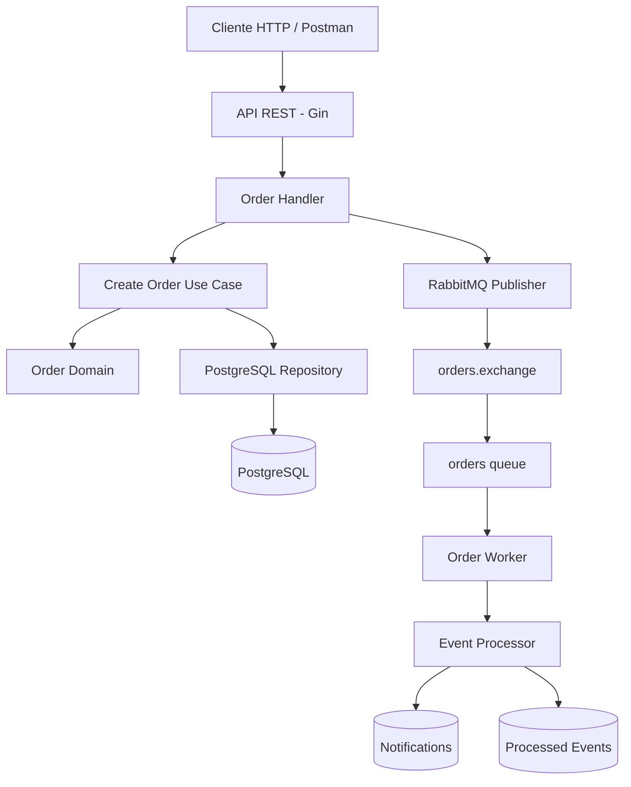

# EVENTFLOW — Sistema de Gestión de Órdenes

API REST desarrollada en Go para la gestión de órdenes, con persistencia en PostgreSQL y procesamiento asíncrono de eventos mediante RabbitMQ.

El proyecto implementa creación y consulta de órdenes, validación de datos, idempotencia, publicación de eventos, consumo mediante un worker independiente y persistencia de notificaciones y eventos procesados.

El entorno local se ejecuta mediante Docker Compose.

---

## 1. Objetivo del proyecto

Desarrollar un sistema backend que permita registrar órdenes y procesar sus eventos de forma asíncrona, aplicando separación de responsabilidades, persistencia de datos y mecanismos básicos de confiabilidad.

El flujo principal contempla:

1. Recibir una solicitud HTTP para crear una orden.
2. Validar los datos y la clave de idempotencia.
3. Persistir la orden en PostgreSQL.
4. Publicar un evento `OrderCreated` en RabbitMQ.
5. Consumir el evento mediante un worker independiente.
6. Procesar el evento y registrar la notificación correspondiente.

El proyecto prioriza una implementación reproducible y una arquitectura sencilla, evitando incorporar infraestructura innecesaria para el alcance solicitado.

## 2. Estado de implementación

| Componente | Estado |
|---|---|
| API REST con Gin | Implementado |
| Health checks v1 y v2 | Implementado |
| Dominio y reglas de negocio | Implementado |
| Persistencia PostgreSQL | Implementado |
| Creación y consulta de órdenes | Implementado |
| Validación de entradas | Implementado |
| Idempotencia | Implementado |
| Publicación de eventos RabbitMQ | Implementado |
| Publisher Confirms | Implementado |
| Worker independiente | Implementado |
| Procesamiento de eventos | Implementado |
| Persistencia de notificaciones | Implementado |
| Reintentos y Dead Letter Queue | Implementado |
| Docker Compose | Implementado |
| Migraciones SQL iniciales | Implementado |
| Swagger | Implementado |
| Outbox Pattern | No implementado |

El proyecto cuenta con pruebas para las principales reglas de negocio, persistencia, idempotencia y comportamiento del publicador. Algunos escenarios de operación y concurrencia del sistema distribuido pueden requerir validaciones adicionales en un entorno de ejecución completo.

## 3. Arquitectura

Se utiliza una arquitectura organizada por responsabilidades, separando el dominio, los casos de uso y los componentes de infraestructura.

### Diagrama de arquitectura



### Flujo de creación y procesamiento

1. El cliente envía una solicitud `POST /api/v1/orders`.
2. La API recibe y valida el contenido de la solicitud.
3. Se verifica la clave `Idempotency-Key`.
4. El caso de uso aplica las reglas de negocio y registra la orden.
5. La API construye el evento `OrderCreated`.
6. El publicador envía el evento a RabbitMQ.
7. El worker consume el mensaje.
8. El procesador registra el evento procesado y genera la notificación.
9. El consumidor confirma el mensaje cuando el procesamiento termina correctamente.

### Decisión arquitectónica

Se utiliza un monolito modular para la API y un proceso independiente para el worker.

Esta decisión permite separar la recepción de solicitudes HTTP del procesamiento asíncrono, sin introducir múltiples microservicios que aumentarían la complejidad del proyecto.

## 4. Tecnologías utilizadas

| Tecnología | Uso |
|---|---|
| Go 1.25.5 | Lenguaje de programación |
| Gin | Framework HTTP |
| PostgreSQL 15 | Persistencia relacional |
| RabbitMQ 3.13 | Mensajería asíncrona |
| Docker | Contenedores |
| Docker Compose | Orquestación local |
| pgx | Conexión con PostgreSQL |
| Zap | Logging estructurado |
| Swagger | Documentación de API |
| PowerShell | Ejecución de pruebas y comandos en Windows |

Las dependencias y sus versiones se encuentran declaradas en `go.mod` y `go.sum`.

## 5. Estructura del proyecto

```text
eventflow/
│
├── cmd/
│   ├── app/                  # Punto de entrada de la API
│   └── worker/               # Punto de entrada del worker
│
├── internal/
│   ├── order/
│   │   ├── domain/           # Entidades y reglas de negocio
│   │   ├── application/      # Casos de uso
│   │   ├── infrastructure/  # Persistencia y adaptadores
│   │   └── ...               # Componentes del módulo
│   │
│   └── ...                   # Otros módulos internos
│
├── pkg/
│   └── amqp/                 # Cliente y funcionalidades RabbitMQ
│
├── migrations/               # Scripts SQL de inicialización
│
├── docs/                     # Documentación Swagger
│
├── Dockerfile                # Imagen de la API
├── Dockerfile.worker         # Imagen del worker
├── compose.yaml              # Servicios del entorno local
├── Makefile                  # Comandos de desarrollo y pruebas
├── .env.example              # Referencia de configuración
├── .gitignore
├── go.mod
├── go.sum
├── test_e2e.ps1              # Pruebas de flujo end-to-end
├── TEST_ENDPOINTS.ps1        # Pruebas de endpoints
└── README.md
```

La estructura separa las reglas de negocio de los detalles de infraestructura. Los componentes de persistencia y mensajería se mantienen fuera del dominio.

## 6. Modelo de dominio

La entidad principal es `Order`.

Una orden contiene:

- Identificador único.
- Identificador del cliente.
- Lista de productos.
- Cantidad de cada producto.
- Precio unitario.
- Total calculado.
- Estado.
- Fecha de creación.

### Reglas de validación

Cada producto debe cumplir las siguientes condiciones:

- El identificador del producto no puede estar vacío.
- La cantidad debe ser mayor que cero.
- El precio unitario no puede ser negativo.
- El cálculo del total debe controlar posibles desbordamientos numéricos.

El total de la orden se calcula utilizando valores enteros (`int64`), evitando errores de precisión propios de los cálculos monetarios con punto flotante.

Las órdenes nuevas comienzan con estado `pending`.

## 7. Base de datos y migraciones

El proyecto utiliza PostgreSQL 15.

### Configuración local

| Parámetro | Valor |
|---|---|
| Host desde el equipo local | `localhost` |
| Host desde los contenedores | `db` |
| Puerto | `5432` |
| Base de datos | `microservice` |
| Usuario | `postgres` |
| Contraseña local de ejemplo | `postgres` |

### Tablas principales

La base de datos contempla las siguientes tablas:

- `orders`: información principal de las órdenes.
- `order_items`: productos asociados a cada orden.
- `health_checks`: registros relacionados con verificaciones de salud.
- `notifications`: notificaciones generadas durante el procesamiento.
- `processed_events`: eventos procesados por el worker.

### Migraciones SQL

Los scripts de inicialización se encuentran en el directorio `migrations/`.

Docker Compose monta este directorio en:

```text
/docker-entrypoint-initdb.d
```

La imagen oficial de PostgreSQL ejecuta los scripts compatibles de ese directorio cuando inicializa un directorio de datos vacío.

**Comportamiento de las migraciones:**

- Primera inicialización: PostgreSQL crea la base de datos y ejecuta los scripts disponibles.
- Reinicios posteriores: se conserva el volumen y no se vuelven a ejecutar los scripts.
- Migraciones nuevas: deben aplicarse explícitamente sobre una base de datos que ya fue inicializada.

Actualmente se utiliza el mecanismo de inicialización de la imagen oficial de PostgreSQL. No se ha incorporado un gestor de versiones de migraciones como Flyway o golang-migrate.

### Ejecución manual de una migración

Si se necesita aplicar un script sobre una base de datos existente, se puede utilizar:

```powershell
docker compose exec db psql -v ON_ERROR_STOP=1 -U postgres -d microservice -f /docker-entrypoint-initdb.d/001_create_health_check.up.sql
```

Se debe ejecutar únicamente la migración que corresponda al estado real de la base de datos. No se deben volver a aplicar indiscriminadamente scripts que ya fueron ejecutados.

## 8. Instalación y ejecución

### Requisitos

- Docker Desktop.
- Docker Compose.
- Git para clonar el repositorio.
- PowerShell para ejecutar los ejemplos de prueba.

No es necesario instalar PostgreSQL ni RabbitMQ directamente en el equipo cuando se utiliza Docker Compose.

### Clonar el repositorio

```powershell
git clone <URL_DEL_REPOSITORIO>
cd eventflow
```

### Levantar el proyecto

Ejecutar:

```powershell
docker compose up --build -d
```

Este comando construye las imágenes y levanta los cuatro servicios:

| Servicio | Función | Puerto |
|---|---|---|
| `db` | PostgreSQL | 5432 |
| `rabbitmq` | RabbitMQ | 5672 |
| `rabbitmq` | Panel de administración | 15672 |
| `app` | API REST | 3200 |
| `worker` | Consumidor de eventos | Interno |

La API y el worker esperan a que PostgreSQL y RabbitMQ superen sus respectivos healthchecks antes de iniciar.

### Revisar los servicios

```powershell
docker compose ps
```

### Consultar logs

```powershell
docker compose logs -f app
docker compose logs -f db
docker compose logs -f rabbitmq
docker compose logs -f worker
```

### Detener el proyecto

```powershell
docker compose down
```

Este comando detiene y elimina los contenedores, pero conserva los volúmenes persistentes.

**Importante:** no utilizar `docker compose down -v` como procedimiento habitual. La opción `-v` elimina los volúmenes y, por tanto, los datos persistidos de PostgreSQL y RabbitMQ.

### Configuración de entorno

El archivo `.env.example` contiene una referencia de las variables de configuración del proyecto.

El `compose.yaml` actual define directamente buena parte de la configuración de la API, el worker y PostgreSQL. Para RabbitMQ permite sobrescribir el usuario y la contraseña mediante `RABBITMQ_USER` y `RABBITMQ_PASSWORD`, utilizando `guest` como valor predeterminado.

Los archivos de entorno locales, como `.env.dev` y `.env.qa`, no deben publicarse en el repositorio.

## 9. API REST

La API queda disponible en:

```text
http://localhost:3200
```

### Health check v1

```http
GET /api/v1/health
```

Permite verificar el estado de la API y su conexión con PostgreSQL.

### Health check v2

```http
GET /api/v2/health
```

Segunda versión del endpoint de salud.

Los healthchecks permiten verificar la disponibilidad de la aplicación y su conexión a la base de datos. No constituyen una validación completa de todas las operaciones del sistema.

### Crear una orden

```http
POST /api/v1/orders
```

Headers:

```http
Content-Type: application/json
Idempotency-Key: order-example-001
```

Body:

```json
{
  "customer_id": "customer-001",
  "items": [
    {
      "product_id": "product-001",
      "quantity": 2,
      "unit_price": 2500
    },
    {
      "product_id": "product-002",
      "quantity": 1,
      "unit_price": 5000
    }
  ]
}
```

El total esperado es:

```text
10000
```

La respuesta exitosa utiliza el código HTTP `201 Created` y entrega los datos de la orden creada.

### Consultar una orden

```http
GET /api/v1/orders/{id}
```

Ejemplo:

```http
GET /api/v1/orders/799207fe-4e4e-4ced-b0ca-454fe7391efd
```

La API devuelve la información de la orden si existe. En caso contrario, responde con `404 Not Found`.

### Códigos de respuesta relevantes

| Código | Significado |
|---|---|
| 201 | Orden creada |
| 200 | Consulta exitosa |
| 400 | Solicitud inválida |
| 404 | Orden no encontrada |
| 409 | Conflicto de idempotencia |
| 500 | Error interno |

### Swagger

La documentación interactiva se encuentra disponible en:

```text
http://localhost:3200/docs/index.html
```

## 10. Idempotencia

La creación de órdenes utiliza el header `Idempotency-Key`.

Su objetivo es evitar que una misma solicitud genere múltiples órdenes cuando el cliente reintenta una operación.

Se contemplan dos situaciones principales:

**Misma clave y mismo contenido**

La solicitud repetida no debe generar una nueva orden y devuelve la orden previamente registrada.

**Misma clave y contenido diferente**

La API responde con `409 Conflict`, evitando reutilizar una clave para operaciones distintas.

Se contemplan pruebas de repetición, conflicto de contenido y comportamiento concurrente de la idempotencia.

La idempotencia se aplica a la creación de órdenes; no reemplaza un mecanismo de transacciones distribuidas entre PostgreSQL y RabbitMQ.

## 11. Mensajería asíncrona con RabbitMQ

RabbitMQ permite desacoplar la creación de órdenes del procesamiento posterior de sus eventos.

### Configuración

| Elemento | Nombre |
|---|---|
| Exchange | `orders.exchange` |
| Tipo | `topic` |
| Cola principal | `orders` |
| Cola de reintentos | `orders.retry` |
| Dead Letter Queue | `orders.dlq` |
| Routing key | `order.created` |

Las colas se configuran como durables.

La cola de reintentos utiliza un TTL de 5000 milisegundos y una configuración de Dead Letter Exchange para devolver los mensajes al flujo correspondiente después del tiempo de espera.

### Evento OrderCreated

Al crear una orden se construye un evento que contiene la información necesaria para que el worker procese la operación.

Ejemplo conceptual:

```json
{
  "event_id": "order.created.799207fe-4e4e-4ced-b0ca-454fe7391efd",
  "event_type": "OrderCreated",
  "order_id": "799207fe-4e4e-4ced-b0ca-454fe7391efd"
}
```

### Worker

El worker se ejecuta como un proceso independiente de la API.

Sus responsabilidades son:

1. Conectarse a RabbitMQ.
2. Consumir mensajes de la cola principal.
3. Procesar los eventos recibidos.
4. Registrar los eventos procesados.
5. Generar las notificaciones correspondientes.
6. Confirmar los mensajes procesados correctamente.

El consumidor utiliza ACK manual y QoS para limitar la cantidad de mensajes entregados simultáneamente.

### Publisher Confirms

El publicador utiliza Publisher Confirms para recibir confirmaciones del broker sobre las publicaciones.

También contempla el manejo de NACK, timeout y mensajes que no pueden ser enrutados cuando se utiliza publicación obligatoria (`mandatory`).

Esto permite mejorar la confiabilidad de la publicación, aunque no garantiza por sí solo la entrega de eventos de extremo a extremo ni reemplaza el patrón Outbox.

### Reintentos y Dead Letter Queue

Cuando ocurre un error durante el procesamiento, el sistema contempla mecanismos de reintento y una cola de mensajes fallidos.

El objetivo es evitar perder inmediatamente un mensaje que no pudo procesarse y permitir aislar los mensajes que agotan los intentos configurados.

La configuración contempla hasta tres reintentos, según los parámetros de implementación.

La estrategia de reintentos y DLQ debe considerarse junto con la idempotencia del procesamiento para evitar efectos duplicados.

## 12. Confiabilidad y limitaciones conocidas

El proyecto implementa distintos mecanismos para mejorar la confiabilidad:

- Validación de entradas.
- Idempotencia en la creación de órdenes.
- Persistencia en PostgreSQL.
- Publisher Confirms.
- Manejo de NACK y timeout.
- ACK manual del consumidor.
- Reintentos y Dead Letter Queue.
- Persistencia de eventos procesados.
- Cierre controlado de procesos.

### Limitación: publicación después de persistir

Actualmente, la orden se persiste en PostgreSQL antes de publicar el evento en RabbitMQ.

Si la publicación falla después de que la orden fue guardada, la API conserva la orden y registra el error de publicación, pero no revierte automáticamente la operación ya persistida.

Esto significa que puede existir una orden registrada cuyo evento no haya llegado al broker.

### Outbox Pattern

Una mejora futura sería implementar el patrón Transactional Outbox.

Este patrón permitiría registrar la orden y el evento pendiente de publicación dentro de una misma transacción de PostgreSQL. Un proceso independiente podría publicar posteriormente los eventos pendientes.

No se implementó en esta versión porque se priorizó mantener el alcance y la complejidad de la solución acotados.

### Otras limitaciones y mejoras futuras

- Incorporar un gestor de migraciones versionadas.
- Completar pruebas de fallos y recuperación de RabbitMQ.
- Profundizar las pruebas de concurrencia del publicador.
- Mejorar la observabilidad y las métricas operacionales.
- Incorporar Outbox para resolver la brecha entre persistencia y publicación.
- Evaluar la operación de la API sin RabbitMQ como dependencia obligatoria.

## 13. Pruebas

El proyecto incluye pruebas automatizadas y scripts para verificar los endpoints y el flujo completo.

### Pruebas automatizadas Go

Para ejecutar todas las pruebas:

```powershell
go test -count=1 ./...
```

Para ejecutar con mayor detalle:

```powershell
go test -v -count=1 ./...
```

Si se desea utilizar un entorno Go en Docker:

```powershell
docker run --rm `
  --mount "type=bind,source=$($PWD.Path),target=/app,readonly" `
  --workdir /app `
  golang:1.25.5-alpine `
  go test -count=1 ./...
```

Las pruebas que requieren servicios externos deben ejecutarse con las dependencias correspondientes disponibles y con su configuración de conexión correcta.

### Scripts de prueba

**Pruebas end-to-end**

```powershell
.\test_e2e.ps1
```

Este script permite verificar el flujo principal de la aplicación, incluyendo disponibilidad, creación de órdenes, persistencia, procesamiento asíncrono e idempotencia.

**Pruebas de endpoints**

```powershell
.\TEST_ENDPOINTS.ps1
```

Permite verificar los endpoints disponibles y sus respuestas.

### Makefile

El proyecto incluye comandos para facilitar la ejecución de tareas habituales:

```powershell
make help
make test
make test-coverage
make test-unit
make test-integration
make test-business
```

La disponibilidad de estos comandos depende de los targets definidos en el `Makefile`. En Windows se puede utilizar un entorno compatible con Make o ejecutar directamente los comandos Go.

### Escenarios de prueba contemplados

| Escenario | Comportamiento esperado |
|---|---|
| Crear una orden válida | La orden se registra |
| Consultar una orden existente | Se devuelve la orden |
| Consultar una orden inexistente | Respuesta 404 |
| Cantidad negativa o cero | Validación rechaza la entrada |
| Precio negativo | Validación rechaza la entrada |
| Cliente o productos faltantes | Solicitud inválida |
| Misma clave y mismo contenido | No crea una segunda orden |
| Misma clave y contenido diferente | Conflicto 409 |
| Evento nulo | El publicador rechaza la operación |
| Timeout de publicación | Se informa el fallo |
| NACK del broker | Se maneja la confirmación negativa |
| Mensaje obligatorio no enrutado | Se contempla el caso de publicación sin ruta |
| Desbordamiento del total | Se rechaza el cálculo inválido |
| Error de procesamiento | Se contempla el mecanismo de reintentos |

Los escenarios anteriores corresponden a los casos contemplados en las pruebas y en la implementación. Para una evaluación de extremo a extremo, es importante conservar evidencia de la ejecución de los casos de fallo, además del flujo exitoso.

## 14. Evidencia de ejecución

Durante las pruebas funcionales se verificó el flujo de creación y consulta de órdenes.

También se comprobó el procesamiento asíncrono mediante los logs del worker.

Ejemplo de log de procesamiento exitoso:

```text
[INFO] Event processed successfully
{
  "event_id": "order.created.799207fe-4e4e-4ced-b0ca-454fe7391efd",
  "order_id": "799207fe-4e4e-4ced-b0ca-454fe7391efd",
  "consumer": "order-worker"
}
```

La evidencia complementaria puede incluir:

- Respuesta de health check.
- Respuesta de creación de orden.
- Consulta de la orden persistida.
- Reutilización de una clave de idempotencia.
- Conflicto por reutilización de clave con otro contenido.
- Logs del worker.
- Registro de la notificación y del evento procesado en PostgreSQL.
- Resultado de pruebas automatizadas.

## 15. Decisiones técnicas y trade-offs

| Decisión | Motivo | Trade-off |
|---|---|---|
| Go | Lenguaje eficiente y adecuado para servicios backend | Requiere definir explícitamente estructuras y manejo de errores |
| Gin | Framework HTTP liviano | Incorpora una dependencia adicional |
| PostgreSQL | Persistencia relacional y transacciones | Requiere administrar esquema y migraciones |
| RabbitMQ | Procesamiento asíncrono y desacoplamiento | Introduce complejidad operacional |
| Worker independiente | Separa procesamiento de solicitudes HTTP | Requiere administrar otro proceso |
| Docker Compose | Entorno local reproducible | No reemplaza una estrategia de despliegue productivo |
| SQL explícito | Control sobre el esquema y las consultas | Las migraciones requieren mayor disciplina |
| Idempotencia | Reduce duplicaciones por reintentos HTTP | Requiere controlar claves y contenido |
| Publisher Confirms | Permite conocer la confirmación del broker | No resuelve por sí solo la atomicidad con PostgreSQL |

Se priorizó una arquitectura simple y explicable, manteniendo las dependencias necesarias para cumplir el objetivo del proyecto.

## 16. Seguridad y configuración

Se consideran las siguientes prácticas:

- Validación de los datos recibidos por la API.
- Variables de configuración para los parámetros de ejecución.
- Exclusión de archivos de entorno locales mediante `.gitignore`.
- Publicación de `.env.example` como referencia.
- Separación de procesos de API y worker.
- Logging estructurado.

Las credenciales incluidas en `compose.yaml` y los valores por defecto de RabbitMQ son exclusivamente para el entorno local de demostración. No deben reutilizarse en producción.

Para un despliegue real se deben utilizar credenciales seguras, gestión de secretos, controles de acceso y configuración adecuada de los servicios.

## 17. Uso de herramientas de IA

Se utilizaron herramientas de IA como apoyo durante el desarrollo.

**ChatGPT**

- Comprensión de conceptos y tecnologías.
- Evaluación de alternativas de arquitectura.
- Revisión de código y decisiones técnicas.
- Propuesta de casos de prueba.
- Apoyo en documentación y análisis de errores.

**GitHub Copilot**

- Apoyo durante la implementación.
- Sugerencias de código.
- Análisis de errores.
- Apoyo en pruebas y documentación.

Las sugerencias generadas fueron revisadas y contrastadas con la implementación y las pruebas. Las decisiones técnicas, la integración de los componentes y la responsabilidad sobre el resultado final corresponden al desarrollador.

## 18. Mejoras futuras

Las siguientes mejoras quedan fuera del alcance de esta versión:

1. Implementar Transactional Outbox.
2. Incorporar un sistema de migraciones versionadas.
3. Profundizar las pruebas de concurrencia y recuperación.
4. Ampliar métricas y trazabilidad de eventos.
5. Mejorar la gestión de secretos y configuración por ambiente.
6. Evaluar estrategias adicionales de resiliencia ante indisponibilidad del broker.

## 19. Conclusión

EVENTFLOW implementa un flujo backend de gestión de órdenes con Go, PostgreSQL y RabbitMQ.

La solución permite crear y consultar órdenes, aplicar validaciones e idempotencia, publicar eventos y procesarlos de forma asíncrona mediante un worker independiente.

Se incorporan mecanismos de confiabilidad como Publisher Confirms, ACK manual, reintentos y Dead Letter Queue, además de pruebas automatizadas y un entorno reproducible mediante Docker Compose.

Las decisiones y limitaciones conocidas se documentan explícitamente, dejando identificadas las mejoras que podrían incorporarse en una siguiente versión.